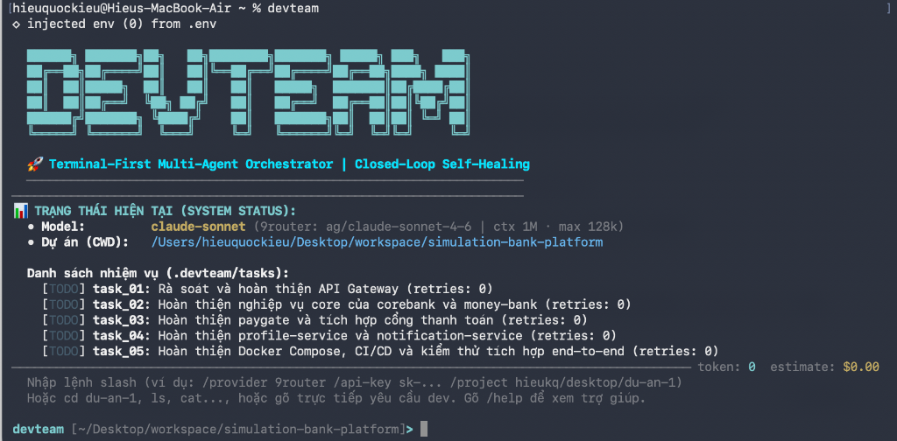

# agent-dev-team

> **Terminal-First Multi-Agent Orchestrator** – Điều phối đội ngũ AI Agent và quản lý các Terminal độc lập trên máy cá nhân, tự động hóa vòng lặp `Code ➔ Test ➔ Self-Healing ➔ Verify`.

[](https://opensource.org/licenses/MIT)
[](https://nodejs.org/)
[](https://www.typescriptlang.org/)
[](https://github.com/langchain-ai/langgraphjs)



---

## 🎯 Vấn đề Giải quyết (The Pain Point)

Khi sử dụng AI (như Claude CLI / Cursor) để lập trình, các lập trình viên thường rơi vào **"Human Relay Loop"** (vòng lặp chuyển phát thủ công vô tận):

```
[Claude CLI] ──(Copy code)──> [IDE: Bấm Run / Test] ──(Báo lỗi)──> [Copy Error Log] ──> [Claude CLI: Nhờ fix] (Lặp lại)
```

1. **Context Switching liên tục**: Bạn phải liên tục Alt+Tab giữa Terminal, IDE (IntelliJ, VSCode) và cửa sổ Chat.
2. **Claude CLI bị chiếm dụng (Single REPL / Blocking)**: Một phiên CLI chỉ làm được một việc tuần tự, không thể vừa mở tiến trình chạy test/dev server ngầm, vừa phân tích và sửa code.
3. **Thiếu Quản lý Trạng thái (State Management)**: Không có cơ chế trung tâm theo dõi task đang ở đâu, lỗi ở bước nào, và tự động chuyển giao thông tin lỗi giữa các tiến trình.

**`agent-dev-team`** giải quyết triệt để vấn đề này: Không cần giao diện web/app cồng kềnh, **toàn bộ được điều khiển ngay trong Terminal**.

---

## 💡 Điểm Đột Phá Cốt Lõi

### 1. Multi-Terminal Sub-Agent Isolation (Hạm đội Sub-Agents trên các Terminal độc lập)
Hệ thống sử dụng **Pseudo-Terminal (PTY)** để spawn và điều phối một hạm đội **Claude Code CLI Sub-Agents** chạy ngầm độc lập trên máy cá nhân:
*   **Terminal 1 (Explorer / Auditor Agent):** Điều phối `claude CLI` tự động bung toàn bộ công cụ (`ripgrep`, `ast-grep`, `ViewTool`, `BashTool`) để khảo sát kiến trúc, review convention, tìm bug nghiệp vụ, audit concurrency & race condition mà không cần con người copy/paste code.
*   **Terminal 2 (Developer Agent):** Điều phối `claude CLI` độc lập để phân tích kiến trúc, refactor, viết mã nguồn và unit test theo nhiệm vụ.
*   **Terminal 3 (Test Runner & Verifier):** Chạy lệnh kiểm thử (`mvn test`, `gradle test`, `npm test`, `pytest`) hoàn toàn độc lập, không block terminal chính.
*   **Terminal 4 (Watcher / Background Service):** Chạy dev-server hoặc linter ngầm khi cần.

### 2. Centralized State Management (Quản lý trạng thái & Ngữ cảnh tập trung)
Toàn bộ tiến trình làm việc được quản lý bằng một **Master State Machine**:
`IDLE` ➔ `PLANNING` ➔ `CODING` ➔ `RUNNING_TEST` ➔ `AUTO_FIXING` ➔ `DONE`.
Mọi trạng thái, nhiệm vụ (`tasks/*.md`), lịch sử hội thoại đa lượt và logs đều được lưu trữ nhất quán, cho phép tạm dừng, phục hồi và kiểm soát an toàn (Human-in-the-Loop).

### 3. Vòng lặp Tự sửa lỗi Khép kín (Closed-Loop Self-Healing)
Khi Terminal Test bắt được exit code khác 0 hoặc stacktrace lỗi:
*   State Manager tự động trích xuất lỗi và đẩy sang Terminal của Claude CLI.
*   Claude CLI tự sửa code và kích hoạt test lại.
*   Bạn không cần copy/paste log thủ công nữa – chỉ cần review kết quả cuối cùng!

---

## 🏗️ Kiến trúc Hệ thống (Architecture)

```
                       🧑‍💻 CON NGƯỜI (Terminal CLI: devteam)
                                      │
                                      ▼
             ┌─────────────────────────────────────────────────────────┐
             │            🏛️ MASTER AGENT ORCHESTRATOR                 │
             │                                                         │
             │  • LangGraph State Engine (Quản lý trạng thái & Graph)  │
             │  • Multi-turn Session Memory (Ghi nhớ ngữ cảnh đối thoại)│
             │  • PO & Architect (Phân rã Master Plan & Tasks)         │
             │  • Human-in-the-Loop & Guardrails (Kiểm duyệt an toàn)  │
             └────────────────────────┬────────────────────────────────┘
                                      │ Điều phối qua PTYManager
        ┌─────────────────────────────┼─────────────────────────────┐
        ▼                             ▼                             ▼
 🖥️ TERMINAL 1 (Explorer)      🖥️ TERMINAL 2 (Dev)          🖥️ TERMINAL 3 (Verifier)
 [Claude Code CLI Sub-Agent]   [Claude Code CLI Sub-Agent]   [Test Runner Process]
                                                            
 • Tự do dùng ripgrep, view    • Đọc kế hoạch & code         • Chạy test độc lập
 • Audit nghiệp vụ & race cond • Refactor & tạo unit test    • Bắt stderr & fail test
 • Xuất báo cáo sâu            • Nhận log lỗi để tự sửa ◄────┤ Bắn Event Self-Healing
```

---

## 👥 Đội ngũ Agent Ảo (Virtual Dev Team)

*   🏛️ **Master Agent (Supervisor / Orchestrator):** Tiếp nhận yêu cầu của người dùng, duy trì ngữ cảnh đối thoại đa lượt, phân tách task và chỉ đạo các Sub-Agent terminal.
*   🔍 **Explorer & Security Auditor (Claude Code CLI Sub-Agent):** Tự động bung công cụ CLI (ripgrep, ast-grep, view) để đọc hiểu dự án, review coding convention, tìm bug nghiệp vụ ngân hàng, race condition và ngoại lệ sai lệch tiền.
*   📋 **Product Owner (PO):** Phân tích yêu cầu cấp cao, chia nhỏ thành các nhiệm vụ cụ thể (`tasks/*.md`).
*   📐 **Solution Architect (SA):** Thiết kế kiến trúc kỹ thuật, interface, quy chuẩn mã nguồn.
*   💻 **Developer (Dev Sub-Agent - Claude Code CLI):** Nhận task và trực tiếp viết mã nguồn, sửa bug trên terminal PTY ngầm.
*   🧪 **Tester (QA Agent & Test Runner):** Kích hoạt terminal kiểm thử, phân tích log lỗi và gửi phản hồi cho Dev Sub-Agent tự sửa.

---

## 📦 Cài đặt (Installation)

### Yêu cầu tiên quyết
*   **Node.js**: >= 18.0.0
*   **npm** hoặc **pnpm**
*   **Claude CLI**: Đã cài đặt trên máy (`npm install -g @anthropic-ai/claude-code`)

### Cài đặt dự án

1. Clone repository:
```bash
git clone https://github.com/Kieuhieu1408/agent-dev-team.git
cd agent-dev-team
```

2. Cài đặt dependencies:
```bash
npm install
```

3. Cấu hình hệ thống (`config.json`):
Tạo file `config.json` ở thư mục dự án (hoặc hệ thống tự động sinh khi chạy lần đầu). File cấu hình tối giản chỉ gồm 3 trường:
```json
{
  "provider": "9router",
  "model": "gemini",
  "apiKey": "sk-your-api-key"
}
```

#### 🤖 2 Combo Model của 9Router:
*   **`gemini` (Mặc định):** Trỏ tới model upstream `ag/gemini-pro-agent` (Context 1.0M, Max output 64k).
*   **`claude-sonnet`:** Trỏ tới model upstream `ag/claude-sonnet-4-6` (Context 1.0M, Max output 128k).

4. Build và liên kết lệnh CLI:
```bash
npm run build
npm link
```

---

## 💻 Hướng dẫn Sử dụng (Usage)

Di chuyển vào bất kỳ thư mục dự án nào trên máy tính của bạn và chạy lệnh:

```bash
# Khởi chạy giao diện điều khiển tương tác (Terminal REPL)
devteam
```

### 📖 Bảng Tra Cứu Các Lệnh (Command Reference)

| Lệnh Slash | Cú pháp | Ý nghĩa & Mô tả |
| :--- | :--- | :--- |
| `/provider` | `/provider <tên> [url]` | Cấu hình AI Provider (`9router`, `openrouter`, `anthropic`, `openai`) |
| `/api-key` | `/api-key <key>` | Cấu hình API Key (`sk-...`) và tự động lưu vào `config.json` |
| `/project` | `/project <đường_dẫn>` | Mở thư mục dự án (hỗ trợ `hieukq/desktop/du-an-1`, `~`, đường dẫn tuyệt đối/tương đối) |
| `/model` | `/model [tên_model]` | Xem danh sách hoặc chuyển đổi model (`gemini`, `claude-sonnet`) |
| `/status` | `/status` | Xem trạng thái chi tiết: file config, provider, model, API key, CWD, và tiến độ task |
| `/tasks` | `/tasks` | Xem danh sách các task chi tiết và tiêu chí nghiệm thu |
| `/logs` | `/logs` | Xem log real-time từ các terminal chạy ngầm (Claude CLI & Test Runner) |
| `/run` | `/run <yêu cầu>` | Khởi chạy vòng lặp phát triển tính năng tự động khép kín |
| `<prompt>` | `<yêu cầu tính năng>` | Gõ trực tiếp yêu cầu bất kỳ tại prompt để bắt đầu dev tính năng |
| `stop` / `/stop` | `stop` | Dừng an toàn tất cả terminal chạy ngầm và lưu checkpoint trạng thái |
| `/help` | `/help` | Hiển thị bảng hướng dẫn cú pháp và thông tin model |
| `/exit` / `/quit` | `/exit` | Dừng an toàn tất cả terminal chạy ngầm và thoát chương trình |

> 💡 **Mẹo:** Bạn có thể thiết lập nhanh chỉ bằng 1 dòng lệnh gộp:
> ```text
> devteam> /provider 9router /api-key sk-xxxx /project hieukq/desktop/du-an-1
> ```
> Hoặc truyền tham số trực tiếp từ terminal:
> ```bash
> devteam /provider 9router /api-key sk-xxxx /project hieukq/desktop/du-an-1
> ```

---

## 🗺️ Lộ trình Phát triển (Roadmap)

- [x] Thiết kế kiến trúc Multi-Agent & State Machine (BRD, SRD, PLAN).
- [x] Xây dựng Core PTY Manager (quản lý đa terminal ngầm với node-pty).
- [x] Tích hợp Claude CLI Driver & Event Parser (tự động bắt lỗi test).
- [x] Xây dựng State Engine & Artifacts Manager (`.devteam/tasks/`, `MASTER_PLAN.json`).
- [x] Hoàn thiện CLI/TUI Interactive Console (`devteam` REPL, Slash Commands).
- [x] Tối ưu hóa file cấu hình tối giản `config.json` và hỗ trợ các combo model 9Router (`gemini`, `claude-sonnet`).
- [ ] Thêm chế độ Human-in-the-Loop (HITL) xác nhận lệnh nguy hiểm.

---

## 📄 Bản quyền (License)

Dự án được phát hành dưới giấy phép [MIT](LICENSE).
